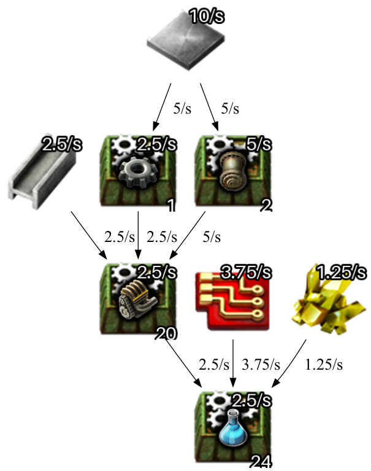
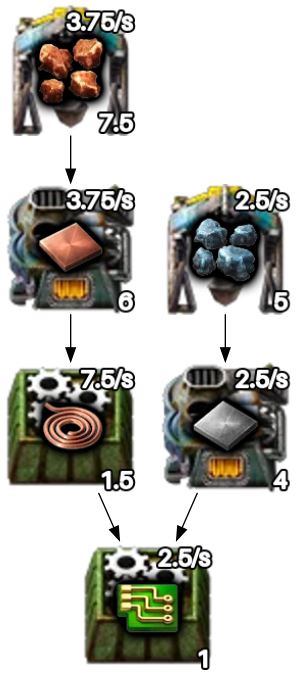
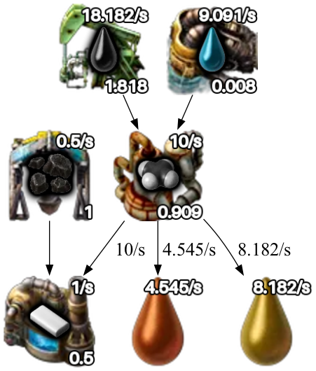

# Factorio blueprint planner

[](https://colab.research.google.com/github/bhedelius/factorio-blueprint-planner/blob/main/factorio_blueprint_planner.ipynb)

Diagrams of the ingredients, machines, and rates needed to make any Factorio product, so builds can be planned as self-contained modules.



Each node shows the product on top of the machine that makes it. The number in the top right is the production rate in items per second and the number in the bottom right is how many machines are needed. Raw materials are drawn without a machine, since they are supplied from outside the module. Each machine node shows its total power use underneath, and the text under the diagram sums it. For burner machines the figure is fuel energy. When an ingredient feeds more than one product, each arrow is labeled with the items per second flowing along it. An ingredient with a single consumer leaves the arrow unlabeled, since its icon already shows that rate.



Recipes with several outputs work too. Outputs that nothing in the diagram consumes hang off the machine as leftovers with their rates, here heavy and light oil from advanced oil processing feeding plastic:



## Usage

The whole tool is the notebook `factorio_blueprint_planner.ipynb`, laid out as two form cells. Open it in Colab with the badge above:

1. Run **Setup** once. It picks the dataset, `2.0` for the base game or `spa` for Space Age, and loads recipes, machines, modules, and icons.
2. Fill in **Design** and run it: product, items per second, and modules. Everything is named as in the game, so type "Chemical science pack" rather than an internal id. Picking "All science packs" as the product draws every science pack instead. The diagram appears under the cell and is saved to `output/`.
3. Under the Design cell, three panels refine the design and redraw the diagram on each change: a ranked list of preferred machines, a searchable raw-material picker, and a dropdown for every item in the diagram that has more than one recipe.

Machines are chosen per recipe from the preference list, which starts as the dataset's upgraded preset (electric mining drill, electric furnace, assembling machine 3). Searching for a machine and pressing Enter puts it first. A recipe none of the preferred machines can run uses its most advanced producer. Two module dropdowns cover mixed loadouts: the secondary module takes its number of slots in each machine and the primary module fills the rest. Productivity modules are only applied where the game allows them, machines with built-in productivity such as the foundry include it, and efficiency modules reduce the power shown under each machine, down to the game's 20 percent floor.

To run it locally instead:

```bash
python -m venv .venv && .venv/bin/pip install -r requirements.txt
brew install graphviz   # or apt install graphviz; the dot binary is required
```

Outside Colab the form fields are plain variables at the top of each cell. The code is hidden in Colab behind the "Show code" toggle.

## Data

All game data comes from [FactorioLab](https://github.com/factoriolab/factoriolab)'s published datasets: one JSON file per game version with items, recipes and their producers, machine speeds, module slots, power use, and module effects, plus a sprite sheet of icons. Nothing about the game is hardcoded in the notebook, so a new game version or the Space Age expansion is a dataset switch. The Setup cell prints the game version the dataset was built from.

## License

The notebook and this documentation are released under the MIT license in `LICENSE`. That license covers only this project's own code and text. FactorioLab's data is MIT licensed by its authors. The icons loaded at runtime and the ones visible in the example images are Factorio's own artwork and belong to Wube Software; they are not covered by this license.

## Limitations

- Beacons, quality, and mining productivity research are not modeled.
- Recipes are chosen per item, not balanced: picking advanced oil processing for petroleum gas shows the heavy and light oil as leftovers rather than cracking them, and a byproduct the chain could reuse, like the hot fluoroketone returned by cryogenic science, is shown as a leftover rather than fed back. A recipe that needs its own product, like asteroid reprocessing, is cut and the item supplied from outside, with a note under the diagram.
- One module loadout applies to every machine.
- Machine counts are shown unrounded so you can choose how to round them.
